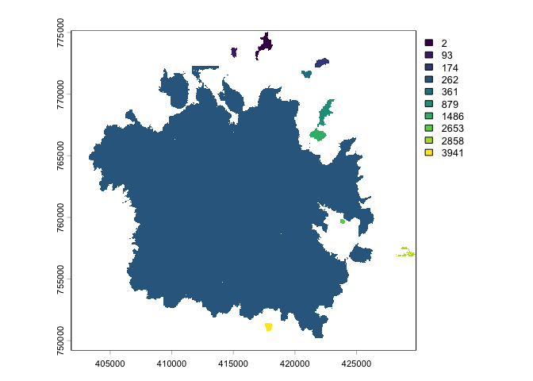
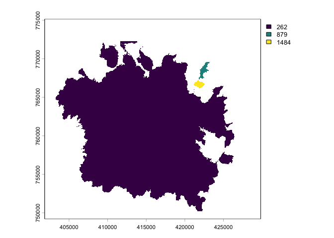
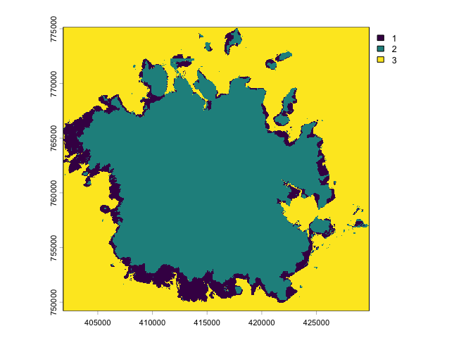

Mangrove modeling, Pohnpei airborne lidar, 2023-2024
================
Jacob A. Comer
2026-11-17

``` r
require(terra)
require(ranger)
require(pROC)
```

``` r
# load in stack of predictor layers and class labels
paths <- yaml::read_yaml('../paths.yml')
predictors <- rast(path.expand(paths$predictors))
labels <- vect(path.expand(paths$labels))

# extract values of predictor layers at labelled locations
vals <- extract(predictors, labels, cells = TRUE, ID = FALSE)

train_df <- data.frame(class = factor(labels$class), vals)
train_df <- train_df[complete.cases(train_df), ]

# extract coordinates from center of each labeled cell
xy <- xyFromCell(predictors, train_df$cell)
train_df$cell <- NULL
print(table(train_df$class))
```

    ## 
    ##   1   2   3 
    ## 350 650 200

Manually labeled data includes 350 mangrove cells (1), 650 non-mangrove
land cells (2), and 200 water cells (3).

Below create 2-by-2-km blocks that will divide the manually labeled data
into five folds for cross-validation.

``` r
set.seed(2113)

# create 2x2-km blocks
block <- paste(floor(xy[, 1] / 2000), floor(xy[, 2] / 2000))
blocks <- unique(block)

# assign each block to one of 5 folds
fold <- sample(rep(1:5, length.out = length(blocks)))[match(block, blocks)]

# identify classes
cls <- levels(train_df$class)  # 1 mangroves, 2 everything else, 3 water

# empty objects to hold predictions
pred_cv <- factor(rep(NA, nrow(train_df)), levels = cls)
prob_cv <- matrix(NA, nrow(train_df), length(cls), dimnames = list(NULL, cls))
```

Run 5-fold cross-validation.

``` r
# 5-fold cross-validation
for (k in 1:5) {
  train_k <- train_df[fold != k, ]
  test_k <- train_df[fold == k, ]
  
  fit <- ranger(class ~ ., data = train_k, num.trees = 500, seed = 2113)
  pred_cv[fold == k] <- predict(fit, data = test_k)$predictions
  
  fit_p <- ranger(class ~ ., data = train_k, num.trees = 500,
                  probability = TRUE, seed = 2113)
  prob_cv[fold == k, ] <- predict(fit_p, data = test_k)$predictions[, cls]
}

confusion <- table(observed = train_df$class, predicted = pred_cv)
print(confusion)
```

    ##         predicted
    ## observed   1   2   3
    ##        1 347   3   0
    ##        2  10 634   6
    ##        3   0   0 200

Other metrics of model performance:

``` r
# calculate precision, recall, and F1 for each class
precision <- diag(confusion) / colSums(confusion)
recall <- diag(confusion) / rowSums(confusion)
f1 <- 2 * precision * recall / (precision + recall)

# calculate AUC for each of the three classes against the other two
auc_for_class <- function(k) {
  roc_k <- roc(response = as.integer(train_df$class == k),
               predictor = prob_cv[, k],
               levels = c(0, 1), direction = '<', quiet = TRUE)
  as.numeric(auc(roc_k))
}

auc_vals <- sapply(cls, auc_for_class)

metrics <- data.frame(class = c('mangrove', 'all else', 'water'),
                      precision, recall, f1, auc = auc_vals)
print(metrics)
```

    ##      class precision    recall        f1       auc
    ## 1 mangrove 0.9719888 0.9914286 0.9816124 0.9983664
    ## 2 all else 0.9952904 0.9753846 0.9852370 0.9965776
    ## 3    water 0.9708738 1.0000000 0.9852217 0.9995900

``` r
colMeans(metrics[, -1]) # macro averages (unweighted by proportional class size)
```

    ## precision    recall        f1       auc 
    ## 0.9793843 0.9889377 0.9840237 0.9981780

``` r
print(sum(diag(confusion)) / sum(confusion))  # overall accuracy
```

    ## [1] 0.9841667

Train a random forest on all the manually labeled data and generate the
mangrove/non-mangrove land/water map.

``` r
ranfor <- ranger(class ~ ., data = train_df, num.trees = 500,
                 importance = 'permutation', seed = 2113)
print(ranfor)
```

    ## Ranger result
    ## 
    ## Call:
    ##  ranger(class ~ ., data = train_df, num.trees = 500, importance = "permutation",      seed = 2113) 
    ## 
    ## Type:                             Classification 
    ## Number of trees:                  500 
    ## Sample size:                      1200 
    ## Number of independent variables:  18 
    ## Mtry:                             4 
    ## Target node size:                 1 
    ## Variable importance mode:         permutation 
    ## Splitrule:                        gini 
    ## OOB prediction error:             1.00 %

``` r
sort(ranfor$variable.importance, decreasing = TRUE)
```

    ##       swir1       swir2         nir    cover_2m       h_p95         mvi 
    ## 0.176448196 0.165415125 0.053381239 0.046873870 0.045402940 0.041926085 
    ##       redge        h_sd        ndvi        ndmi         red       n_pts 
    ## 0.036654768 0.034606504 0.031548004 0.026804300 0.018758932 0.017931671 
    ##        elev       green        blue ground_frac  ground_int    low_frac 
    ## 0.016824192 0.015517413 0.008957743 0.004895920 0.004894385 0.002292862

``` r
# define function to convert terra::predict output from factor to integer
ranfor_fun <- function(model, data, ...) {
  as.integer(as.character(predict(model, data = data)$predictions))
}

class_map <- predict(predictors, ranfor, fun = ranfor_fun, na.rm = TRUE)
```

Clean up and derive measures from the output. This includes calculating
how much of the output map remains NA due to cloud cover, calculating
the size of the gap in the center of the DTM, etc.

``` r
# define function to calculate area of binary mask positives
area_km2 <- function(r) {
  n_cells <- global(r, 'sum', na.rm = TRUE)[[1]]
  cell_area_m2 <- prod(res(r))
  n_cells * cell_area_m2 / 1000000
}

# read in and resample the DTM
dtm <- rast(path.expand(paths$dtm))
dtm_10m <- resample(dtm, predictors$nir, method = 'average')

# total area skipped within modeled area
cloud_na <- is.na(class_map) & !is.na(predictors$elev)

# scanned ground above the modeling elevation cutoff
cutoff <- 175
high <- subst(dtm_10m >= cutoff, NA, 0)

# find central gap in the DTM. First, group connected cells into patches
p <- patches(ifel(is.na(dtm_10m), 1, NA), directions = 8)
nr <- nrow(p)
nc <- ncol(p)

# identify raster edge cells
edge_cells <- c(cellFromRowCol(p, 1, 1:nc), cellFromRowCol(p, nr, 1:nc),
                cellFromRowCol(p, 1:nr, 1), cellFromRowCol(p, 1:nr, nc))

# identify the patches to which the edge cells belong
edge_ids <- unique(na.omit(p[edge_cells][, 1]))

# find patch sizes
sizes <- freq(p)

# ignore patches that touch the raster edges
interior <- sizes[!sizes$value %in% edge_ids, ]

# find the largest interior patch
gap <- subst(p == interior$value[which.max(interior$count)], NA, 0)

# fill in the class map
final_map <- class_map
final_map <- ifel(is.na(final_map) & (high == 1 | gap == 1), 2, final_map)
final_map <- ifel(is.na(final_map) & !cloud_na, 3, final_map)

# fill the tiny gaps left in the final map by cloud cover
filled <- final_map
for (i in 1:20) {
  filled <- focal(filled, w = 3, fun = 'modal', na.policy = 'only',
                  na.rm = TRUE)
  n_left <- global(cloud_na & is.na(filled), 'sum', na.rm = TRUE)[[1]]
  if (n_left == 0) break
}
final_filled <- ifel(cloud_na, filled, final_map)
area_km2(cloud_na)
```

    ## [1] 0.0539

``` r
# areas of the three classes (1 mangrove, 2 everything else, 3 water)
f <- freq(final_filled)
f$km2 <- f$count * prod(res(final_filled)) / 1000000
f
```

    ##   layer value   count      km2
    ## 1     1     1  573662  57.3662
    ## 2     1     2 3030866 303.0866
    ## 3     1     3 3661676 366.1676

``` r
# calculate mainland area; start by grouping final_map == 2 into patches
land <- ifel(final_filled == 2, 1, NA)
id <- patches(land, directions = 8)

# rank patches by size
size <- freq(id)[, c('value', 'count')]
size <- size[order(size$count, decreasing = TRUE), ]
size$km2 <- size$count * prod(res(id)) / 1000000
head(size, 10)
```

    ##      value   count      km2
    ## 241    262 2952670 295.2670
    ## 753    879   12135   1.2135
    ## 2        2   11171   1.1171
    ## 1234  1486    8443   0.8443
    ## 159    174    5586   0.5586
    ## 325    361    3790   0.3790
    ## 3402  3941    3168   0.3168
    ## 2462  2858    3095   0.3095
    ## 80      93    2886   0.2886
    ## 2283  2653    1246   0.1246

``` r
# map the 10 largest, colored by patch ID, to see which is which
top10 <- ifel(id %in% size$value[1:10], id, NA)
plot(top10, type = 'classes')
```

<!-- -->

``` r
# Sokehs and Temwen are already included with mainland; include Takaieu
# and Dehpehk as well
mainland_ids <- size$value[c(1, 2, 4)]
mainland <- ifel(id %in% mainland_ids, id, NA)

# there are some tiny patches of mainland misclassified as mangrove; fill them
mainland_2 <- ifel(id %in% mainland_ids, 1, NA)
footprint <- fillHoles(as.polygons(mainland_2))
in_main <- rasterize(footprint, final_filled, background = 0)
sv <- sieve(final_filled, threshold = 20, directions = 8) # max gap 2000 m ^ 2
final_fixed <- ifel(in_main == 1 & (final_filled == 1 | is.na(final_filled)),
                    sv, final_filled)

# recalculate mainland area from fixed mainland patch
land <- ifel(final_fixed == 2, 1, NA)
id <- patches(land, directions = 8)
size <- freq(id)[, c('value', 'count')]
size <- size[order(size$count, decreasing = TRUE), ]
size$km2 <- size$count * prod(res(id)) / 1000000
mainland_ids <- size$value[c(1, 2, 4)]
mainland <- ifel(id %in% mainland_ids, id, NA)
# Mainland here includes the land-tied islands of Sokehs, Temwen, Takaieu, and
# Dehpehk
plot(mainland)  # (no mangroves)
```

<!-- -->

``` r
# find all land patches that are not included with the mainland
others <- size[!(size$value %in% mainland_ids), ]

# threshold them by area
min_cells <- 200  # this equates to 20000 m ^ 2
others <- others[others$count >= min_cells, ]

# find mean canopy height of those patches
ch <- ifel(predictors$h_p95 < 0, NA, predictors$h_p95)
other_ch <- zonal(ch, id, fun = 'mean', na.rm = TRUE)
names(other_ch) <- c('value', 'mean_h')
others <- merge(others, other_ch, by = 'value')

# we count as small islands only small land patches that have a mean
# canopy height of 2 m or more; if no vegetation, probably reef
small_islands <- others[!is.na(others$mean_h) & others$mean_h >= 2, ]
small_island_patches <- ifel(id %in% small_islands$value, 1, 0)

mangrove_binary <- ifel(final_fixed == 1, 1, NA)

print(paste0('Mainland size: ', sum(size$km2[size$value %in% mainland_ids])))
```

    ## [1] "Mainland size: 297.3667"

``` r
print(paste0('Gap size: ', area_km2(gap)))
```

    ## [1] "Gap size: 61.2285"

``` r
print(paste0('Mangrove area: ', area_km2(mangrove_binary)))
```

    ## [1] "Mangrove area: 57.3145"

``` r
print(paste0('Lagoon islands area: ', sum(small_islands$km2)))
```

    ## [1] "Lagoon islands area: 3.9533"

``` r
print(paste0('Mainland, lagoon islands, and mangroves: ',
             sum(size$km2[size$value %in% mainland_ids]) + 
             area_km2(mangrove_binary) + 
             sum(small_islands$km2)))
```

    ## [1] "Mainland, lagoon islands, and mangroves: 358.6345"

``` r
print(paste0('Surveyed area: ',
             sum(size$km2[size$value %in% mainland_ids]) -
             area_km2(gap) +
             area_km2(mangrove_binary) +
             sum(small_islands$km2)))
```

    ## [1] "Surveyed area: 297.406"

The overall, final mangrove/non-mangrove land/water map:

``` r
plot(final_fixed)
```

<!-- -->
Write to disk a raster layer that identifies the two land groups,
mainland and lagoon islands, and dropping the unsurveyed gap.

``` r
land_groups <- ifel(id %in% mainland_ids & gap == 0, 1,
                    ifel(id %in% small_islands$value, 2, NA))
writeRaster(land_groups, path.expand(paths$land_groups), overwrite = TRUE)
```
